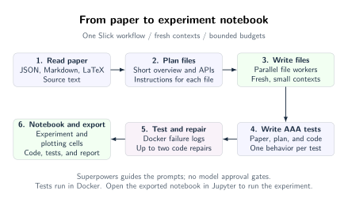

# Paper2Code-Slick

Turn a JSON, Markdown, or LaTeX paper into a tested Python repository using a
bounded Slick workflow. Independent tasks use fresh, small contexts; the
controller accepts code only after Docker checks and a separate review pass.

This is the `improved` branch of the [Paper2Code fork](https://github.com/StuartFarmer/Paper2Code-Slick).
The old sequential implementation has been replaced. GEPA remains V2 work.



[TikZ source](assets/workflow.tex) · [Design and limitations](docs/superpowers/specs/2026-10-13-improved-workflow-design.md)

## Install and run

Use Python 3.10+ and a running Docker daemon. Slick is installed from PyPI;
no Slick Git checkout is needed. With `uv`, run from this repository:

```bash
uv sync --locked
bash scripts/build-executor.sh
export OPENROUTER_API_KEY="<your-new-openrouter-key>"
set -o pipefail
uv run python -m codes.workflow \
  /Users/stuart/Developer/AI/arXiv-2103.16196v2/paper/main.tex \
  --model openai/gpt-oss-120b:nitro \
  --output-dir outputs/AlphaEvolve_improved \
  --output-repo-dir outputs/AlphaEvolve_improved_repo \
  2>&1 | tee AlphaEvolve_improved.log
```

Alternatively, in your own activated environment, install `pip install -r requirements.txt`
(which installs `slick-ai[openai]` from PyPI), then use `python` in place of `uv run python`.
Do not run `uv init`: the project is already configured. `uv pip install` can target a
different active environment; `uv sync` installs the project's locked environment.

The executor lock currently targets **Linux ARM64 / Python 3.11**, tested using
Docker Desktop on Apple Silicon. It includes CPU-only PyTorch, NumPy, pandas,
SciPy, PyYAML, pytest and Hypothesis. An x86 image needs a separately resolved and
verified wheel lock. Generated projects cannot install extra dependencies during checks.

The paper argument accepts extracted `.json`, `.md`/`.markdown`, or `.tex`, not
PDFs or directories. LaTeX is indexed without expanding external `\input` files;
unresolved references remain visible in the evidence. Missing method references
identified during extraction block the run and are retained in the report. Supply consolidated source
when relevant methods live in other files.

Defaults are `openai/gpt-oss-120b:nitro`, `outputs/Transformer`, and
`outputs/Transformer_repo`. **Both output directories must be unused**, distinct,
and not nested. Existing files are never overwritten by a new run. V1 supports
OpenRouter IDs only; `codex` and `claude` CLI aliases fail before any model call.
Use `--planner-model` and `--reviewer-model` for explicit role overrides. Nothing
automatically escalates to a larger model.

## Workflow

1. Index source excerpts and exact evidence spans. Extract requirements in parallel;
   reconcile typed specification and task fragments with explicit interfaces.
2. Author and review tests independently of candidate code. Each property names
   its source requirement, input domain, oracle and numerical tolerance. Exercise
   those tests against contract scaffolding, then freeze the acceptance suite.
3. Schedule ready tasks in dependency order. Each task owns disjoint files and
   receives relevant source, interfaces, tests, and selected dependency code.
4. Generate a candidate, run syntax/import/pytest checks in Docker, and review it
   in a fresh session. Diagnose failures before bounded production-code repair.
5. Recombine accepted tasks, run the complete suite and integration smoke, review
   source fidelity, and export the accepted snapshot plus its tests.

A model's `pass` cannot override missing or failing execution evidence. The
container has no network or API credentials, a read-only filesystem and mounts,
a non-root user, one CPU, 2 GiB RAM, and bounded output. Docker isolates generated
execution from the host; it is not a proof against deliberately adversarial code
that manipulates its own Python process.

| Budget | Default |
| --- | --- |
| Concurrent model / Docker calls | 4 / 2 |
| Total model calls, including repairs | 120 |
| Active run time / per-call timeout | 3600 s / 600 s |
| Rendered input, including schema | 32,768 UTF-8 bytes |
| Output tokens | 8192 |
| Schema repairs per response | 2 |
| Code fixes / context expansions per task | 2 / 2 |

Use `--max-calls`, `--run-timeout`, `--concurrency`, and `--test-concurrency` to
set a run's budgets. Large indivisible packets stop with a context-budget error;
they are never silently truncated. Transport failures stop the run without hidden retries.
Tests, interfaces or source interpretations needing correction block the current
run; start a new reviewed run after correcting the input or prompts. Workers cannot
weaken their own tests. Hypothesis uses deterministic generation/shrinking and
records actual statistics where available; stub failures are not property calibration.

## Logs and resume

Each operation prints its role, task, attempt and durable call ID. The run directory contains:

| Path | Evidence |
| --- | --- |
| `manifest.json`, `artifacts.json` | Frozen input hashes, image, models, budgets and artifact inventory |
| `source/`, `prompts/` | Original source, indexed spans, frozen prompts |
| `spec.json`, `plan.json`, `suite.json` | Typed, validated planning and acceptance artifacts |
| `calls/` | Prompt, raw Slick history, reservation and outcome for every attempt |
| `tasks/`, `integration/`, `executor/` | Candidates, diagnoses, reviews, measured checks and bounded logs |
| `report.md`, `report.json` | Run outcome and source → requirement → property → test → execution links |
| `accepted/` | Final snapshot, created only after integration and fidelity gates |

```bash
uv run python -m codes.workflow --resume outputs/AlphaEvolve_improved
```

Resume locks the run, verifies frozen artifacts, code, prompts, dependencies and
image, and reuses accepted tasks and checks. New settings cannot be mixed with
`--resume`. Interrupted reservations still count; a clean pause does not consume
active time, but unobserved downtime after a hard crash is conservatively charged.
Stale containers belonging to that locked run are removed before continuing.
Completed-run verification requires Docker but no API key. Incomplete runs exit
nonzero; Ctrl-C exits 130 after cleanup and retains evidence.

Cost and token measurements are `null` when unavailable, never inferred as zero.
Reports distinguish method checks, engineering deviations and deferred empirical
claims. Passing synthetic tests does **not** establish the paper's published scores,
mathematical proofs, or equivalence to a larger model. Generated properties remain
explicitly uncalibrated unless separately evaluated.

## Development and evaluation

```bash
uv run pytest
P2C_TEST_IMAGE="$(docker image inspect paper2code-executor:local --format '{{.Id}}')" \
  uv run pytest tests/test_docker_integration.py
uv run python -m eval.run calibrate --output-dir outputs/evaluation/controls-new
uv run python -m eval.run run --stage micro --output-dir outputs/evaluation/nitro-micro
```

The first command tests the controller offline; Docker checks are opt-in. The
calibration command runs three frozen correct/fault pairs (six Docker checks),
covering constant-output false positives, annualization and full-period scaling.
The micro trial uses the exact GPT-OSS Nitro ID with 30 calls / 15 minutes and
external acceptance tests withheld from model repair. Human adjudication and
property-review judgments remain separate from automated control results.
Component (60 calls / 30 minutes) and full (120 calls / 60 minutes) stages require
`--paper` and a passing `--previous path/to/evaluation.json`. They currently rely
on generated acceptance checks; their external scientific validation remains manual.
See [evaluation notes](eval/README.md) for evidence boundaries and baseline provenance.

`codes/agent.py` owns the Slick workflow; `codes/workflow.py` owns the CLI.
Contracts, planning validation, source indexing, storage and Docker execution
live in their corresponding `codes/` modules. Local prompts are under
`codes/prompts/improved/`. Convenience scripts `scripts/run.sh` and
`scripts/run_latex.sh` use the same CLI and accept `PAPER_PATH`, `MODEL_NAME`,
`OUTPUT_DIR`, `OUTPUT_REPO_DIR`, and `PYTHON` environment overrides.

Rebuild the diagram with `pdflatex` into a temporary directory, then run
`pdftocairo -svg workflow.pdf assets/workflow.svg`; commit both the TikZ source
and SVG. Prompt adaptations and their licenses are recorded in [NOTICE](NOTICE).

Based on *Paper2Code: Automating Code Generation from Scientific Papers in Machine
Learning* ([paper](https://arxiv.org/abs/2504.17192),
[upstream](https://github.com/going-doer/Paper2Code)). Original benchmark results
have not been revalidated for this workflow.
