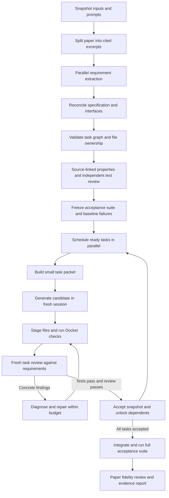

> Historical design: superseded by the simple plan → files → tests → repair workflow.
> See the repository README for current behavior.

# Improved Paper2Code workflow

> Current behavior amendment: the user requested useful imperfect code rather than
> strict review gates that prevent all output. Generation now precedes acceptance
> preparation, and draft dependencies can unblock downstream generation. Spec
> objections and missing references are warnings; unverified candidates are
> exported as drafts, never labelled accepted. The README is the current usage
> contract; verified-only export requirements below describe the earlier design.


Status: proposed design; implementation and paid evaluation have not started.
Branch: `improved`. Requested by Stuart: plan first, then test with
`openai/gpt-oss-120b:nitro`. The current working changes predate this design;
the planning commit does not establish a clean executable baseline.

Companion documents:

- [Pydantic contracts](2026-10-13-improved-workflow-contracts.md)
- [Tools and Docker](2026-10-13-improved-workflow-execution.md)
- [Implementation plan](../plans/2026-10-13-improved-workflow.md)
- [Property testing and scientific fidelity research](../../research_property_fidelity/integration.md)

## Intent and evidence

Test whether many bounded, short-context tasks on small/medium models can produce
a reliable research implementation at lower total cost than a large-model run.
Parallelism is a scheduling choice; fidelity and correctness require independent
evidence. Matching a large model is a hypothesis, not an acceptance claim.

The saved AlphaEvolve OpenRouter run has four planning calls, fifteen analysis
calls, and fifteen coding calls. Logged analysis contexts are about 98,000
characters each; coding contexts grow from 111,478 to 325,392 characters. These
are character counts, not token measurements, and exclude any provider-side
context not represented in those strings.

Original responses in `outputs/AlphaEvolve_openrouter/calls/coding/` contain
parameter-generator addition in `baseline_lstm.py`, normalization before splitting
in `feature_engineer.py`, and an annualization factor cancelling itself in metric
code. These need different judgments: the supplied paper explicitly specifies
all-time normalization (`paper/main.tex:301`), so train-only scaling is an
engineering deviation, not a correction required for literal replication.
Annualization conventions also need an explicit contract. The original task list
has no tests. The output repository now contains
later repairs; use saved calls, not its current files, to evaluate the original
generation. Current orchestration saves files but never executes them.

The recently added Pydantic healer repairs design/task representation failures.
It does not test code behavior, scientific meaning, or cross-file compatibility.

## Scope

V1 generates Python research repositories from JSON extraction, Markdown, or
LaTeX text. It creates a source-grounded specification, explicit interface
contracts, a task dependency graph, acceptance tests, isolated implementations,
bounded repairs, and a final evidence report. Generation stays in Slick;
scheduling, filesystem operations, Docker, and acceptance are ordinary Python.

Keep a single owning `PaperCoder` class with a short `@workflow run()` and
operation-specific local Jinja prompts. Use `@prompt(output_type=Model)` at
structured generation boundaries. No agent framework, service mesh, queue,
vector database, nested agents, or model-native tool-calling requirement.

Non-goals: GPU training in V1, automatically provisioning datasets, unrestricted
dependency installation, full arXiv project ingestion, automatic deployment,
and claims that passing tests proves exact replication or predictive value.
Unresolved data or methodological requirements must appear in the final report.
GEPA investigation and prompt optimization are V2; V1 only preserves the versioned
prompts, trajectories and measured feedback that can support that later research.

## Binding defaults

These are proposed engineering defaults, not measured optimums:

- Host Python remains 3.10+; the first Linux execution image uses Python 3.11.
- All initial model roles use `openai/gpt-oss-120b:nitro`; no silent stronger-model fallback.
- At most four concurrent model calls and two concurrent Docker checks per run.
- Each provider call has a 600-second timeout and an 8,192-output-token ceiling.
- Fully rendered model input is limited to 32,768 UTF-8 bytes, including schema,
  excerpts, repair evidence, and any history. Record estimated tokens separately;
  this byte limit is not an exact 8k-token limit.
- Source excerpts are at most 12,288 UTF-8 bytes; oversized sections split at
  paragraph/algorithm boundaries while retaining source spans and cross-reference IDs.
- At most two schema repairs per logical generation, two code-fix rounds per
  task, and two additional context requests per task. These share the run budget.
- Default run limits: 120 dispatched model calls and 3,600 seconds elapsed.
  Every initial, repair, review, extraction, and context-follow-up call counts.
- Required Docker checks must run; Docker absence never selects a host-execution fallback.
- Models propose changes; the controller owns acceptance, writes, test commands,
  budgets, and durable state. A model cannot set a task to accepted.

Elapsed-time limits count cumulative active controller time across invocations;
paused downtime is excluded. Image build time is measured separately. Limits are
explicit CLI/run settings and frozen in the run manifest. Budget
exhaustion yields `incomplete`, never a successful repository verdict. Paid-run
cost is reported only when measured; unknown usage or cost is null, not zero.

## Flow



### 1. Snapshot and extract

Snapshot paper bytes, prompt bytes, implementation revision plus dirty-source
hash, schema version, dependency lock, run settings, and Superpowers revision.
This prevents a running process from mixing edited templates with older code.
The existing Codex failure log contains a template `StrictUndefined` error;
it is a controller/template error, not a model error eligible for healing.

Preserve a normalized source with stable line numbers and a mapping back to
the original input. JSON extraction maps spans to normalized text and JSON
locations. Preserve LaTeX equations and labels as text; do not execute TeX.
External includes are listed as unresolved inputs, not silently fabricated.

Extract requirements independently per excerpt. Each finding identifies a
verifiable source span, exact quote, implementation requirement, and ambiguities.
Verify quotes against the snapshot in Python. Merge overlapping findings and
resolve referenced definitions before treating a section as self-contained.
For a large paper, reduce bounded batches through intermediate summaries that
retain source IDs; never concatenate every extraction into an unbounded prompt.

### 2. Reconcile specification and task graph

A planner resolves duplicates and contradictions, records justified assumptions,
and creates interfaces with names, signatures, data shapes, units, timing, state
ownership, and errors. A fresh specification review compares these decisions
with the cited source. Material uncertainty stays explicit and can block a task.
No majority vote between models can establish a scientific fact.

Decompose by independently testable behavior rather than one task per file.
Usually a task owns one to three small production files. The controller rejects
cycles, missing dependencies, duplicate IDs, multiple production owners, missing
requirement coverage, and consumption of an interface without its owning task
as an ancestor. Shared config/types have a single owner and are accepted first.
Test-file ownership belongs to the independent acceptance suite.

V1 freezes contracts before dispatch. A worker needing an interface change
returns `blocked` with a concrete reason. A bounded plan revision creates a new
plan hash and invalidates affected tasks and descendants. It never silently
changes an interface while its consumers are running.

Planning is incremental: `reconcile_spec` returns a `PaperSpec` fragment for one
bounded requirement group, and `plan_tasks` returns a `TaskPlan` fragment for that
group. A first bounded architecture pass assigns stable component/interface IDs;
subsequent calls receive only the relevant registry entries and global invariants.
The controller merges fragments by ID and checks every producer/consumer pair,
not just each fragment. Semantic conflicts go to a focused reconciliation call
containing the two conflicting entries and their source evidence. No prompt must
return the entire accumulated specification or task graph. Oversized groups split
before dispatch; an indivisible oversized contract blocks the run explicitly.
All partition/reconciliation calls consume the same global budget.

### 3. Author and freeze tests

A test-author prompt sees requirements, source evidence, and interfaces, but
not candidate implementation. A different fresh context reviews the tests for
meaningful assertions, forbidden assumptions, and paper fidelity. Small numeric
examples with hand-checkable expected values are preferred.

Each `TestSuite` fragment includes `PropertySpec` records linking requirements
to test nodes, justified relationships, domains, oracles and tolerances. Reuse
`review_tests` to check both source entailment and executable test quality; no
new permanent agent. Pair useful invariants/metamorphic tests with independent
numeric anchors so constant-output programs cannot pass by consistency alone.
Use examples when no meaningful generated property is justified. Classify
empirical claims separately and defer them explicitly when V1 lacks their data
or experiment; never convert a performance claim into a universal invariant.

Tests run against contract scaffolding first. An expected missing implementation
failure is useful RED evidence; a syntax error, missing third-party dependency,
or faulty fixture is an infrastructure/test defect. Test review checks that
failures cover the intended behavior. Tests already passing are recorded as such,
not represented as RED evidence. Freeze the approved test hash before coding.

Author and review one task's tests at a time; use separate bounded calls for
interface-edge tests and the small end-to-end smoke test. These operations return
`TestSuite` fragments, which Python assembles into the complete immutable suite.
Each fragment owns a distinct `tests/acceptance/<task-or-integration-id>/` prefix.
Task test authoring may run in parallel after contracts freeze. Do not send the
whole growing suite to any author/reviewer. The controller verifies that the
assembled suite covers every task and contains integration targets before freezing.

An implementation cannot delete, rewrite, skip, or xfail acceptance tests.
Legitimate test corrections require a separate test review, a new suite hash,
and invalidation of all dependent evidence. Test validity remains fallible;
keep a curated evaluation suite outside model-editable artifacts.
Selected external evaluation properties also get a correct-reference/known-fault
calibration pair. A stub failure is not semantic calibration. Uncalibrated
properties remain labelled as such; generic runs do not invent trusted oracles.
The executor uses bounded Hypothesis checks and preserves counterexamples, health
outcomes and replay provenance as specified in the execution companion.

### 4. Implement ready tasks

Build a task packet from its brief, a compact global invariant list, referenced
paper excerpts, required interfaces, relevant accepted dependency code, and its
acceptance tests. Never include the whole paper or all previous code by default.
The task can request identified excerpts/symbols, within its context budget.
Oversize packets are split/replanned or blocked; no semantic truncation.

Each task gets its own workspace and fresh Slick session. Each attempt returns
structured file content or a typed context/blocker response. The controller
checks allowed paths and byte limits before staging a candidate. It then runs
fixed Docker checks and supplies measured results to an independent reviewer.

A reviewer returns findings with requirement IDs and artifact/line evidence,
including spec compliance and quality. Acceptance requires all required checks
passing, no blocking findings, and evidence matching the candidate/contract/test
hashes. A prose claim of success is insufficient.

### 5. Repair, integrate, and finish

Syntax/schema errors use the existing bounded schema-repair idea. Behavioral
failures go to a diagnosis prompt with focused test output, relevant code, and
contracts. It returns a root-cause hypothesis, evidence, and intended fix. The
diagnosis distinguishes code defects, invalid properties/generators, unresolved
source interpretation and infrastructure failures before routing a repair. The
repair prompt receives only the affected files and findings. Re-review covers
the fix and prior findings rather than restarting a broad review each time.

Two unsuccessful fixes block the task and its descendants. Independent sibling
work can finish and be saved; global time/call exhaustion or cancellation stops
new dispatches and cancels active work. Configuration/provider errors stop the
affected run without speculative code repair. No automatic paid transport retry
in V1; a later resume is explicit and counted.

The controller integrates accepted disjoint production bundles serially. Before
accepting a candidate, compare its dependency hashes to the current accepted
snapshot. Stale candidates are rejected and rescheduled within budget. Run the
whole acceptance suite after integration and a tiny end-to-end synthetic smoke
test. Integration failures identify owning task(s); reopen them and invalidate
descendants instead of patching a completed repository outside the task ledger.

A bounded final fidelity review checks requirement coverage and recorded
deviations using task evidence. Large projects are reviewed by requirement group
before a compact final reconciliation. Report separate outcomes: code generated,
tests verified, integration verified, and paper requirements supported/deviated/
unresolved. Never equate these with reproducing published numerical results.
The controller derives the requirement -> property -> test -> execution links;
fresh model reviewers cannot replace missing execution or empirical evidence.

## Persistence and observability

One controller owns a run directory and a filesystem lock. Immutable artifacts
are written by temporary-file plus atomic rename; a controller-owned journal
records state transitions. Parallel workers have unique task/attempt directories.
No shared `planning.json` writer across concurrent calls.

```text
run/
  manifest.json                 # versions, hashes, settings; no credentials
  source/                       # original and normalized input, span map
  spec.json
  plan.json
  events.jsonl                  # controller-owned transitions and durations
  calls/<call-id>.json           # rendered prompt, raw reply, model, timing, usage
  tasks/<task-id>/brief.json
  tasks/<task-id>/attempts/<n>/   # candidate, checks, findings, diagnosis
  acceptance/                   # versioned, frozen tests
  accepted/                     # controller-published production snapshot
  report.json
  report.md
```

Resume verifies frozen settings, code/prompts, source, dependencies, image,
contracts, tests, and accepted output hashes. It reuses valid accepted tasks and
never promotes a merely in-progress result. Calls with unknown outcomes remain
counted; repeating them needs an explicit resume and may duplicate API spend.
Changed versions require a new run, not silent mutation of completed evidence.
Persist attempts/budgets so restarting cannot reset repair allowances.

Print task ID, stage, attempt, active/ready/blocked counts, model, and elapsed
time. Save full bounded execution output as an artifact and include a focused
tail in model packets. Bind every test result to its image and candidate hashes.
Capture provider token/cost metadata only when the installed adapter exposes it;
otherwise record unavailable values and estimated prompt size explicitly.

## Adapting Superpowers

Reference snapshot inspected: submodule `bb92a77`. Copy selected role instructions
into `codes/prompts/`, retaining attribution and MIT notice in `NOTICE` and
`third_party/superpowers-LICENSE`. Record the source file/revision alongside each
adapted prompt. The runtime must not require discovering installed skills.

| Source | Adaptation |
| --- | --- |
| writing-plans | Exact consumed/produced interfaces and checkable task briefs |
| subagent-driven-development/implementer-prompt | Bounded ownership, explicit context needs, no nested delegation |
| task-reviewer-prompt | Independent requirements/quality findings grounded in artifacts |
| re-review-prompt | Finding-by-finding fix verification |
| dispatching-parallel-agents | Only independent tasks, isolated state, controlled integration |
| test-driven-development | RED/GREEN evidence produced by the runner |
| systematic-debugging | One supported root-cause hypothesis before a local fix |
| verification-before-completion | Controller gates completion on current evidence |

Omit platform-specific Skill invocations, recursive agents, per-worker Git
commits, unrestricted terminal commands, and human approval at every task.
Workers return artifacts; Python schedules and integrates them. Preserve useful
judgment instructions, but enforce budgets and completion in code.

Also adapt the focused property-authoring/review guidance from Trail of Bits and
claim/evidence reasoning from K-Dense, as mapped in the research companion. Pin
source revisions and retain their applicable attribution/licenses when copying.
They extend existing test/spec/fidelity prompts, not the runtime role graph.

## Model routing and evaluation

For the first experiment, every role uses the user's exact OpenRouter ID,
including `:nitro`. Preserve the suffix; do not replace it with a different
provider/model silently. Validate availability in the later paid preflight.
`--model` sets every role; optional `--planner-model` and `--reviewer-model`
overrides are explicit and recorded. V1 verified runs support OpenRouter API
models only. Recognize `codex`/`claude` aliases but reject them before paid work
with a clear unsupported-backend message. Existing CLI behavior remains in the
frozen baseline. Installed CLI adapters can run tools on the host and hide
internal calls/context; they cannot satisfy the execution and accounting contract.
An isolated CLI backend is a separate follow-up, not an implicit fallback.

Evaluation stages, in order:

1. **Offline workflow checks:** scripted provider, actual templates/Pydantic,
   malformed output, false review claims, bounded repairs, DAG concurrency,
   cancellation, dependency invalidation, and resume. No paid calls.
2. **Docker checks:** real image, trivial pass/fail/import error, timeout and
   descendant cleanup, immutable mounts, log limits, no secrets/network, and
   persisted result hashes. Missing Docker is an explicit prerequisite failure.
3. **Small-model micro-run:** a short bundled numerical-method specification with
   two independent tasks and one integrating task. All roles use GPT OSS Nitro.
   Maximum 30 model calls and 15 minutes; no stronger fallback. Require external
   acceptance tests and final integration to pass before progressing.
4. **AlphaEvolve component run:** source-grounded preprocessing, one symbolic
   operator, and metric calculation against synthetic data. Maximum 60 calls,
   30 minutes. Tests include exact numerical cases and an explicitly declared
   train-only-normalization engineering deviation. Literal full-period scaling
   has a separate reference fixture; do not silently relabel it as a code bug.
   This is a component evaluation, not replication. Calibrate selected tests and
   reviewer decisions against frozen correct/faulty/invalid-property fixtures;
   at most six reference/fault pairs (12 checks) inside the existing time budget.
5. **Full workflow:** one bounded AlphaEvolve generation using the 120-call/
   60-minute defaults. CPU-only synthetic smoke, no dataset downloads or full
   training. Report missing data and approximations explicitly.
6. **Comparative evaluation:** separate approved experiment after smoke success.
   Compare old/new workflows crossed with small/large model on the same frozen
   papers, independent tests, and compute budgets. Use repeated runs (start with
   three per condition); report every failure and human intervention. Measure
   requirement fidelity, test pass rate, integration success, wall time, all
   calls/repairs, and actual cost when available. Do not compare against the
   manually repaired output repository as if it were an original large-model run.

A smaller-model successful smoke establishes functioning plumbing and bounded
task solving, not large-model equivalence. A strong baseline model and monetary
budget for stage 6 remain choices for that later experiment; they do not block
implementation or the requested GPT OSS smoke.

## Implementation status (2026-10-13)

The verified V1 controller, CLI, Docker executor, prompts and offline evaluation
fixtures are implemented on `improved`. Use the current README for executable
commands. Task 11's paid GPT-OSS stages and independent human adjudication have
not run; an OpenRouter key is absent in the development environment.

Implementation amendments: `codes/agent.py` owns the workflow and
`codes/workflow.py` the CLI; `run_verified` handles exceptions outside Slick's
restricted workflow syntax. The initial CPU wheel lock is Linux ARM64.
Oversized interface registries or indivisible packets block instead of silently
truncating evidence; automatic pairwise repartition is not implemented. Test/spec
corrections require a new reviewed run; only implementation/schema repair is
automatic. Component/full trial scientific adjudication remains manual.
These boundaries narrow the original plan and are not evidence that its entire
evaluation ladder or all proposed acceptance cases have been completed.
